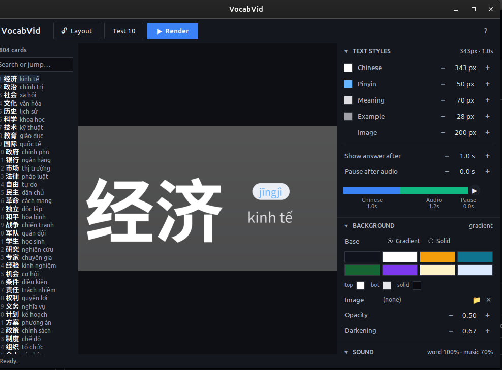
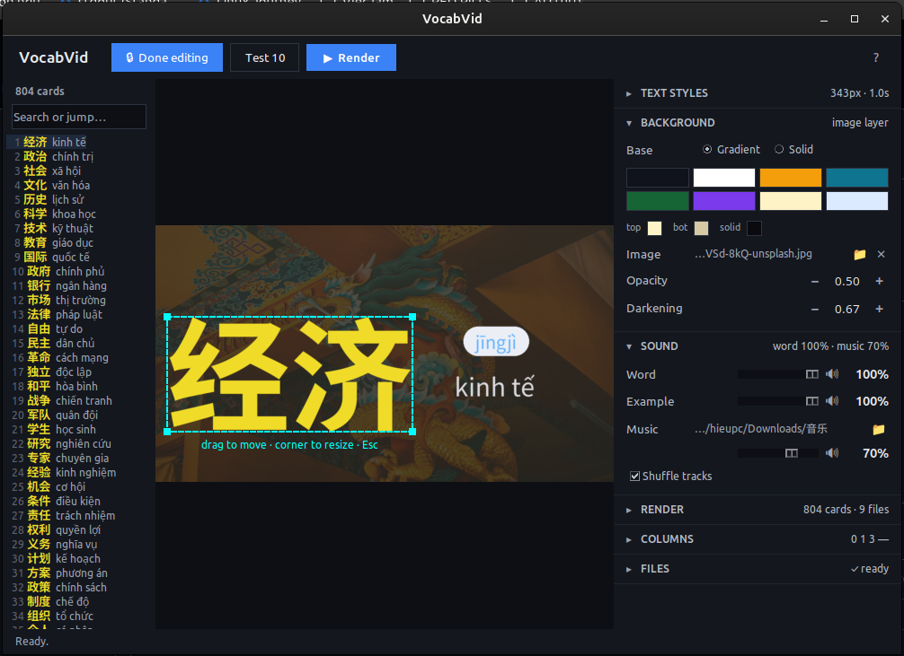
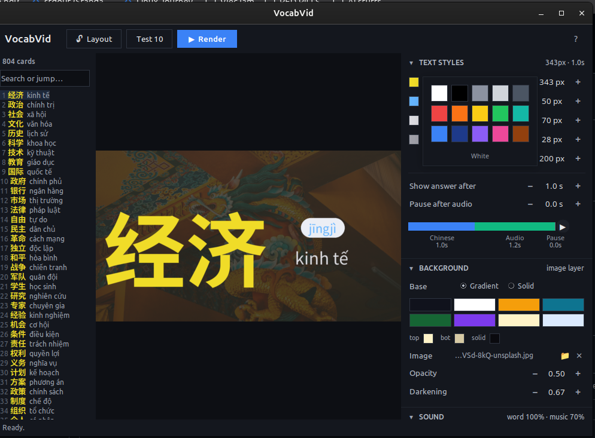

# VocabVid

Turn your Anki vocab deck into a study video — Chinese, Japanese, Vietnamese, and more.

## Features

- Preview-first — see every style change live before rendering
- Drag-and-drop layout — move and resize each field directly on the preview
- Chapter splitting — render 800+ cards as multiple files
- Background music — loop a folder of tracks under the entire video
- Guaranteed-clean output — verified to have exactly one video and one audio stream
- Fast — per-card caching means re-renders only rebuild what changed
- Auto-detects Anki's media folder and column layout

## Requirements

- Python 3.10+
- ffmpeg installed and on your PATH
  - Ubuntu/Debian: sudo apt install ffmpeg
  - macOS: brew install ffmpeg
  - Windows: winget install ffmpeg
- CJK font (for Chinese/Japanese/Korean)
  - Ubuntu/Debian: sudo apt install fonts-noto-cjk

## Install from source

    git clone https://github.com/hillrichie532-hash/vocabvid.git
    cd vocabvid
    python3 -m venv venv
    source venv/bin/activate
    pip install -r requirements.txt
    python vocabvid.py

## How to use

1. Export your Anki deck
   - Browse -> select notes -> Notes -> Export -> Plain Text (.txt)
   - Save as vocab.txt

2. Open VocabVid
   - Auto-detects Anki media folder if in a standard location
   - Otherwise: FILES section -> Media -> Browse -> point at collection.media

3. Adjust the look
   - TEXT STYLES: fonts, colors, sizes, timing
   - BACKGROUND: gradient, solid, or image
   - SOUND: volume for word audio, example audio, background music
   - COLUMNS: verify Chinese/Pinyin/Meaning map to the right columns

4. Test first
   - Click Test 10 in the top bar
   - Output: ~/Videos/vocab_test.mp4

5. Render the full deck
   - Click Render
   - Output: ~/Videos/vocab_01.mp4, vocab_02.mp4, ...

## Layout mode

Click Layout in the top bar, then:
- Click a field on the preview to select
- Drag it to reposition
- Drag a corner handle to resize
- Press Esc to deselect

## Keyboard shortcuts

- Left / Right: previous / next card
- Esc: deselect
- Enter: jump to card (in search box)

## Build from source

    ./build.sh
    # Output: dist/VocabVid

## License

MIT
